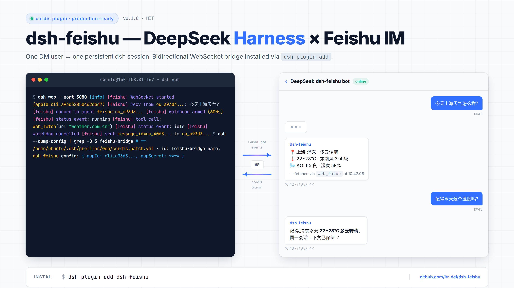

# dsh-feishu — 飞书/Lark IM 桥接 DeepSeek Harness

> 可插拔 cordis 插件，把飞书自建机器人接入运行中的
> [DeepSeek Harness (dsh)](https://github.com/deepseek-ai/deepseek-harness) `web`
> profile —— 通过 `dsh plugin add` 一行安装。

```
┌────────┐   WS    ┌──────────────┐   cordis    ┌──────────┐    LLM    ┌──────────┐
│ 飞书 IM │ ──────> │  本插件      │ ──────────> │ dsh agent │ ────────> │ DeepSeek │
│        │ <────── │              │ <────────── │          │ <──────── │          │
└────────┘   API   └──────────────┘  events     └──────────┘  stream   └──────────┘
```



## 功能

- 一个飞书私聊用户 ↔ 一个持久化 dsh 会话（`feishu:<open_id>`）。
- 多轮对话跨重连保持。
- 把助手回复流回飞书，4000 字分块。
- 过滤 DeepSeek `<|DSML|...>` 工具调用标记。
- **交互式提问桥接**：模型调用 `ask_user_question` 时，问题（含选项）会被渲染成文本发到飞书，
  并立刻解开死锁 —— 否则在纯 IM 部署下这个工具会一直挂到超时（它只接受 dsh web 浏览器端的回答）。
- **进度回传**：turn 跑超过 45 秒还没结束，就每 30 秒把新产出的正文增量发一次「进行中」消息。
  长任务不再全程静默。
- **超时看门狗**：turn 卡死时强制 `agent.cancel()` 并通知用户，阈值可配（默认 30 分钟）。
- 纯 ESM，无需 TypeScript 编译。
- 无遥测、完全本地。

## 安装

### 1. 安装 dsh

```bash
npm install -g @deepseek-ai/dsh
dsh web --help
```

### 2. 安装本插件

```bash
dsh plugin add dsh-feishu
```

会自动装到 `~/.dsh/profiles/web/node_modules/dsh-feishu` 并写入 `cordis.patch.yml`。

### 3. 配置飞书应用

到 <https://open.feishu.cn/app> 创建**自建应用**，复制 `appId` + `appSecret`。

在**事件与回调**里：
- 订阅方式选**使用长连接接收事件/回调**。
- 添加事件 `im.message.receive_v1`。

在**权限**里授予：
- `im:message`
- `im:message.p2p_msg`（私聊必需）

**发布版本** —— 没发布就收不到事件。发布后等约 2 分钟缓存刷新。

### 4. 导出环境变量并启动

```bash
export DEEPSEEK_API_KEY="sk-..."
export FEISHU_APP_ID="cli_..."
export FEISHU_APP_SECRET="..."

dsh web
```

日志里应该看到：

```
[feishu] WebSocket started (appId=cli_xxx)
[feishu] FeishuBridgeService initialized
```

给机器人发私聊消息，agent 会在同一会话里回复。

## 环境变量

| 变量 | 必需 | 默认 | 备注 |
|---|---|---|---|
| `DEEPSEEK_API_KEY` | 是（LLM 调用） | — | <https://platform.deepseek.com> |
| `DEEPSEEK_BASE_URL` | 否 | `https://api.deepseek.com` | 代理场景 |
| `FEISHU_APP_ID` | 是 | — | 应用控制台里的 `cli_xxx` |
| `FEISHU_APP_SECRET` | 是 | — | 应用控制台 —— **切勿提交** |
| `DSH_FEISHU_WATCHDOG_TIMEOUT_MS` | 否 | `1800000`（30 分钟） | turn 卡死的强制取消阈值 |
| `DSH_FEISHU_PROGRESS_AFTER_MS` | 否 | `45000` | 本轮跑多久之后才开始发进度更新 |
| `DSH_FEISHU_PROGRESS_INTERVAL_MS` | 否 | `30000` | 相邻两条进度更新的最小间隔 |

## 消息流

1. 用户私聊机器人。
2. 飞书 SDK 触发 `im.message.receive_v1` → 本插件。
3. 插件为 `feishu:<open_id>` 加载/创建 agent。
4. 插件调用 `agent.followup(userMessage)`。
5. agent 回到 `idle` 后，插件读取 `agent.session.events`，过滤 DSML 噪声，通过
   `larkClient.im.message.create(...)` 把回复发回飞书。
6. turn 进行期间，一个 2 秒轮询的看门狗负责两件事：发现**未结算的 `ask_user_question` 调用**
   就把它转投到飞书并取消该轮（解死锁）；turn 超过阈值就把正文增量作为「进行中」消息发出。
   `ask_user_question` 与最终回复共用同一个 seq 游标，所以同一段文字不会发两遍。

## 限制

- **仅文本**。图片/文件/卡片/post 消息未处理。
- **非增量 token 流式**。回复仍按整段发送；turn 进行中只有周期性「进度更新」（见上）。
- **暂不支持群聊**。仅私聊。
- **交互式 UI 工具降级**：`ask_user_question` / `exit_plan_mode` 在 dsh 里只接受 web 端回答。
  IM 场景下插件会把问题转成文本并取消该轮（同时注入环境约束，让模型优先直接用正文提问）。

## 协议

MIT。

## 致谢（第三方来源）

- [DeepSeek Harness (dsh)](https://github.com/deepseek-ai/deepseek-harness) —— 本插件所扩展的 Agent 运行时。
- [@larksuiteoapi/node-sdk](https://github.com/larksuite/node-sdk) —— 飞书官方 SDK，MIT 协议。
- [DeepSeek API](https://platform.deepseek.com) —— 大模型后端。

## 作者

[itr-del](https://github.com/itr-del) — `13918029394@163.com`

在 Ubuntu 22.04 上集成 dsh 与自托管飞书机器人过程中编写。

English docs: [README.md](./README.md)。